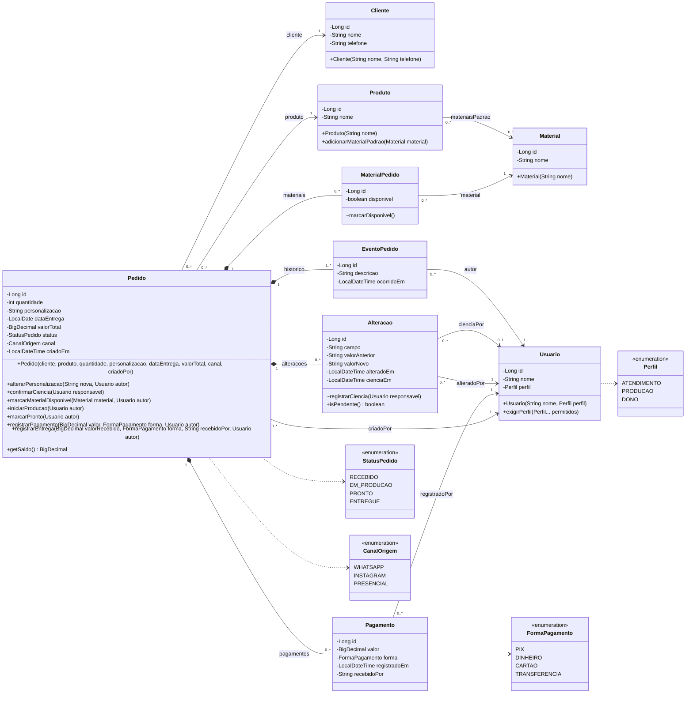

# Fichário de Encomendas

API em Java e Spring Boot para organizar os pedidos de uma pequena empresa de produtos personalizados sob encomenda.

## O problema

Os pedidos chegam por WhatsApp, Instagram e balcão e ficam anotados em celulares, cadernos e planilhas. Ninguém tem uma visão única do pedido, e isso gera erros que custam dinheiro para a empresa.

## O que o sistema resolve

| Situação na empresa | Como o sistema trata |
|---|---|
| O cliente muda o pedido e a produção não fica sabendo | A alteração fica pendente até a produção confirmar que viu |
| A produção começa e para por falta de material | A produção só inicia com todos os materiais marcados como disponíveis |
| Compras feitas sem saber o que realmente falta | Lista de compras com os materiais em falta de cada pedido |
| Ninguém sabe em que etapa está cada encomenda | Fila da produção com o status de cada pedido |
| Produto entregue sem conferir o pagamento | O saldo é calculado pelo sistema, e a entrega só fecha com ele quitado |

## Como rodar

Precisa apenas do **JDK 21**. O projeto já traz o Maven Wrapper.

```bash
./mvnw spring-boot:run      # API em http://localhost:8080
./mvnw test                 # testes
```

No Windows (CMD ou PowerShell), troque `./mvnw` por `mvnw.cmd`.

Ao iniciar, a aplicação cria dados de exemplo para testar: os usuários Ana (id 1, atendimento), Beto (id 2, produção) e Marcos (id 3, dono), o produto "Kit festa" e a cliente Maria Souza.

## Rotas da API

Como ainda não há login, o id de quem faz a operação vai no cabeçalho `X-Usuario-Id`.

**Clientes:** `POST /clientes` · `GET /clientes` · `GET /clientes/{id}`

**Pedidos:** `POST /pedidos` · `GET /pedidos` · `GET /pedidos/{id}`

**Alterações:** `PUT /pedidos/{id}/personalizacao` · `POST /pedidos/{id}/ciencia`

**Produção:** `GET /producao/fila` · `POST /pedidos/{id}/iniciar-producao` · `POST /pedidos/{id}/pronto`

**Pagamentos:** `POST /pedidos/{id}/pagamentos` · `POST /pedidos/{id}/entrega`

**Materiais:** `GET /materiais` · `GET /compras` · `PUT /pedidos/{id}/materiais/{materialId}/disponivel`

## Arquitetura escolhida

**Monolito em camadas** (controller, service e repository), com o código **separado por módulo**: cada parte do negócio tem a sua pasta.

Por que essa escolha:

- **Pelo negócio:** tudo depende do pedido. Clientes, alterações, materiais e pagamentos estão ligados a ele, então faz sentido ficarem numa só aplicação, com um só banco.
- **Pela complexidade:** o sistema é um cadastro com regras, para uma empresa de oito pessoas. Dividir em microsserviços traria custo sem benefício.
- **Pela equipe:** estamos aprendendo Spring Boot, e o padrão em camadas é o mais usado na documentação. Separar por módulo deixa claro onde está o código de cada integrante.

As **regras de negócio ficam nas entidades**, principalmente em `Pedido`. Os services apenas buscam os dados, chamam essas regras e devolvem a resposta.

## Estrutura de pastas

```text
src/main/java/br/com/fichario
├── config          dados de exemplo e respostas de erro
├── shared          exceções e validações comuns
└── internal        um pacote por módulo
    ├── cliente     controller · dto · entity · mapper · repository · service
    ├── pedido      controller · dto · entity · mapper · repository · service
    ├── alteracao   controller · dto · service
    ├── producao    controller · service
    ├── pagamento   controller · dto · service
    ├── material    controller · dto · entity · mapper · repository · service
    ├── produto     entity · repository
    └── usuario     entity · repository
```

Cada módulo tem só os pacotes de que precisa. Alterações, produção e pagamentos trabalham direto sobre o `Pedido`, por isso não têm entidade própria. `Pagamento`, `Alteracao`, `MaterialPedido` e `EventoPedido` ficam junto do `Pedido`, porque só ele cria e altera essas classes.

## Diagrama de classes



O GitHub desenha o diagrama a partir deste código. A mesma fonte está em `docs/diagrama-classes.mmd`.

## Integrantes

- Eike Sales
- Flavio Eugenio
- Gustavo Interamnense
- Igor Maia
- Miguel Angelus

**Tecnologias:** Java 21 · Spring Boot · Spring Web · Spring Data JPA · Bean Validation · H2 · Lombok · Maven
