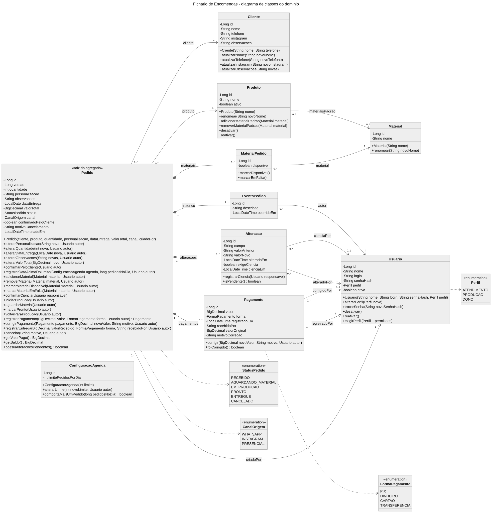

# Fichário de Encomendas

Sistema de pedidos para uma pequena empresa de produtos personalizados sob encomenda.

Hoje os pedidos chegam por WhatsApp, Instagram e balcão e ficam espalhados em celulares, cadernos e planilhas. Isso causa três erros recorrentes:

- alterações que não chegam à produção;
- produção iniciada sem o material necessário;
- entregas feitas sem conferir o saldo a receber.

O sistema cria uma **fonte única sobre cada pedido**: dados, alterações, materiais, pagamentos, status e histórico.

Esta é a **Etapa 2** do projeto: modelagem do domínio e definição da arquitetura. Controllers, services e endpoints ficam para a próxima etapa.

## Escopo da primeira versão

- O atendente registra o pedido feito pelo cliente no WhatsApp. Não há bot nem integração automática.
- Uma alteração feita pelo atendimento fica pendente até a produção confirmar ciência.
- A produção só começa com todos os materiais disponíveis.
- O saldo é calculado pelo sistema, a partir dos pagamentos, e nunca digitado.
- A entrega só fecha com o saldo completo recebido e com o nome de quem recebeu.
- Somente o dono cancela pedidos e corrige pagamentos, sempre com motivo registrado.
- Um limite de pedidos por dia avisa o atendente antes de prometer um prazo.

## Diagrama de classes



Arquivos do diagrama:

- [`docs/diagrama-classes.mmd`](docs/diagrama-classes.mmd): fonte em Mermaid. Edite este arquivo quando o modelo mudar.
- [`docs/diagrama-classes.svg`](docs/diagrama-classes.svg) e [`docs/diagrama-classes.png`](docs/diagrama-classes.png): imagens geradas a partir da fonte.

### Entidades

| Entidade | Papel | Relacionamentos JPA |
|---|---|---|
| `Pedido` | Raiz do agregado. Concentra todas as regras do pedido. | `@ManyToOne` Cliente, Produto, Usuario (criadoPor). `@OneToMany` MaterialPedido, Pagamento, Alteracao, EventoPedido |
| `Cliente` | Quem encomenda. Identificado pelo telefone, que é único. | Referenciado por Pedido |
| `Produto` | Item do catálogo, com a lista padrão de materiais. | `@ManyToMany` Material (tabela `produto_material`) |
| `Material` | Insumo da produção. | Referenciado por Produto e MaterialPedido |
| `MaterialPedido` | Material de um pedido e sua situação: disponível ou falta comprar. | `@ManyToOne` Pedido, Material |
| `Pagamento` | Sinal, parcial ou saldo. Correções guardam o valor original. | `@ManyToOne` Pedido, Usuario (registradoPor, corrigidoPor) |
| `Alteracao` | Mudança de um campo, com ciência da produção. | `@ManyToOne` Pedido, Usuario (alteradoPor, cienciaPor) |
| `EventoPedido` | Linha imutável do histórico. | `@ManyToOne` Pedido, Usuario (autor) |
| `Usuario` | Funcionário com login e perfil. | Referenciado pelas entidades acima |
| `ConfiguracaoAgenda` | Limite de pedidos por dia de entrega. | Nenhum |

Enums: `StatusPedido`, `CanalOrigem`, `FormaPagamento` e `Perfil`.

### Encapsulamento

As entidades não têm setters públicos. Cada mudança de estado é um método com nome do negócio, que valida a regra antes de alterar o dado. Por exemplo, `alterarPersonalizacao`, `confirmarCiencia`, `registrarPagamento` e `registrarEntrega`.

- `Pagamento`, `Alteracao`, `MaterialPedido` e `EventoPedido` são criados e alterados somente por `Pedido`. Por isso seus construtores e modificadores são visíveis apenas dentro do pacote.
- As listas são devolvidas como somente leitura.
- `Pedido` tem `@Version`, para impedir que duas pessoas salvem versões diferentes do mesmo pedido ao mesmo tempo.
- Regras violadas lançam `RegraDeNegocioException`.

## Arquitetura

**Arquitetura em camadas** (Controller, Service, Repository), com **modelo de domínio rico**: as regras de negócio ficam nas entidades, e não espalhadas pelos services.

### Justificativa

- **Necessidade do negócio.** O problema da empresa é de regras, e não de integração. Exemplos: só entregar com o saldo quitado, só produzir depois da ciência da alteração. Colocar essas regras nas entidades garante que valham em qualquer tela ou endpoint futuro, e permite testá-las sem banco nem servidor.
- **Complexidade do sistema.** O sistema é um CRUD com regras, usado por uma equipe de oito pessoas e com um único banco de dados. Arquiteturas como a hexagonal ou a Clean Architecture pedem portas, adaptadores e mapeamento entre modelos. Isso dobraria o número de classes sem resolver um problema real desta empresa.
- **Características da equipe.** A equipe está aprendendo Spring Boot e JPA. O padrão em camadas é o que o próprio Spring adota e o que mais aparece em documentação e exemplos, o que reduz a curva de aprendizado. Cada integrante entende onde cada código fica.
- **Evolução.** Se no futuro surgir uma integração, como um formulário de pedidos ou a API do WhatsApp, ela entra como um novo controller ou service. O domínio não muda.

### Organização do código

```
src/main/java/br/com/fichario
├── FicharioApplication.java      ponto de entrada do Spring Boot
├── domain
│   ├── model                     entidades JPA, enums e regras de negócio (Etapa 2)
│   └── exception                 RegraDeNegocioException
├── repository                    interfaces Spring Data JPA (próxima etapa)
├── service                       casos de uso e transações: busca, chama o domínio e salva (próxima etapa)
└── controller                    endpoints REST e DTOs de entrada e saída (próxima etapa)
```

Regras de dependência:

- `controller` usa `service`;
- `service` usa `repository` e `domain`;
- `domain` não depende de nenhuma outra camada.

As consultas que cruzam vários pedidos ficam no `service`, pois precisam do banco. É o caso de contar os pedidos de um dia para comparar com o limite da agenda.

## Tecnologias

- Java 21
- Spring Boot 3.3 (Spring Data JPA / Hibernate)
- H2 em memória para desenvolvimento e testes
- JUnit 5 e AssertJ

## Como executar

Pré-requisito: JDK 21 instalado, com `JAVA_HOME` apontando para ele. O Maven não precisa estar instalado, porque o projeto usa o Maven Wrapper.

Rodar os testes:

```bash
./mvnw test
```

No Windows (PowerShell ou CMD):

```bash
mvnw.cmd test
```

Os testes cobrem:

- `PedidoTest`: regras de negócio, sem banco.
- `MapeamentoJpaTest`: salva um pedido com todos os relacionamentos no H2 e lê de volta, conferindo o mapeamento JPA.

Subir a aplicação, que nesta etapa só cria o esquema do banco:

```bash
./mvnw spring-boot:run
```

## Equipe

<!-- Preencha com os nomes dos integrantes -->
- Flavio Eugenio
- Eike Sales
- Miguel Angelus
- Gustavo Interaminense
- Igor Maia
